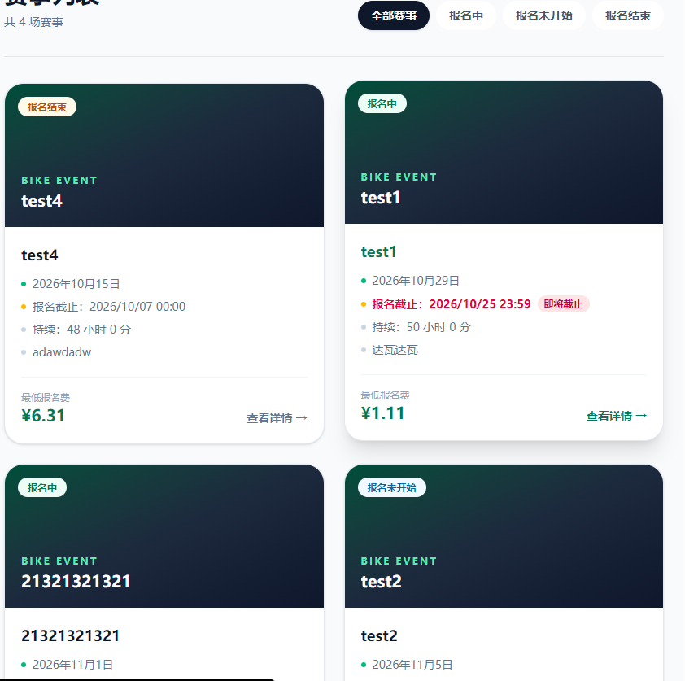
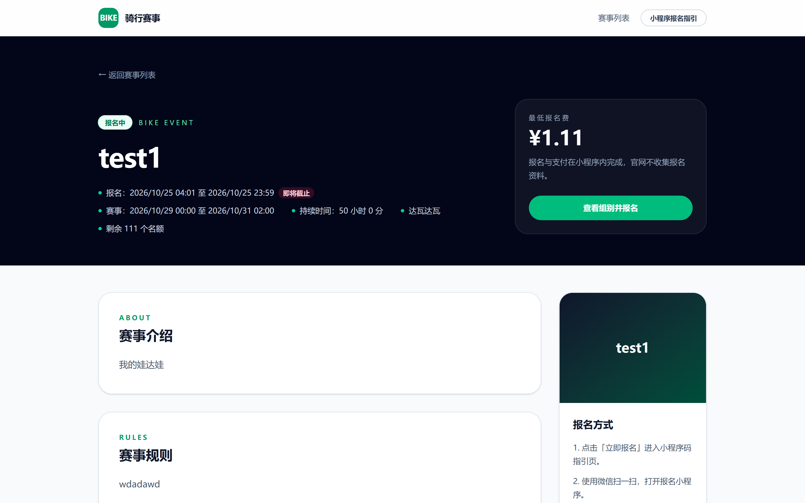
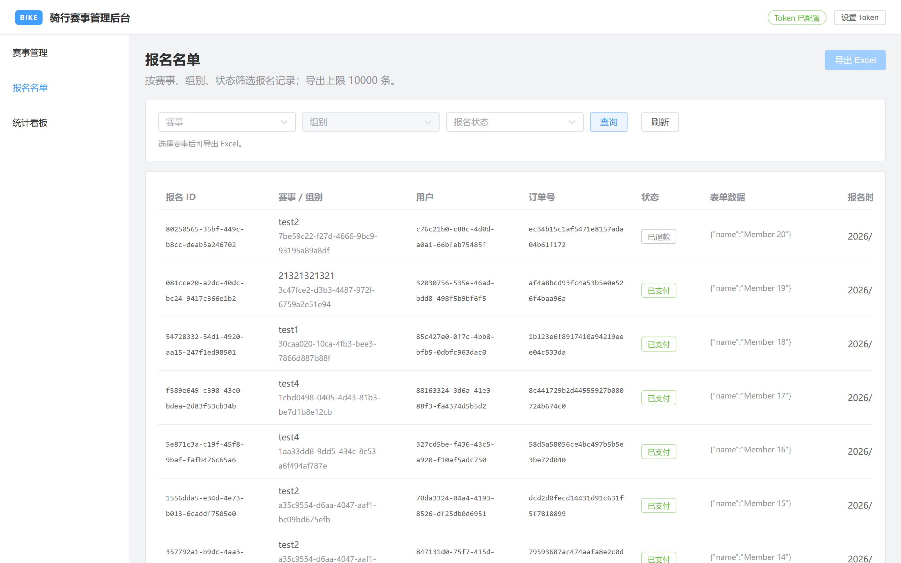
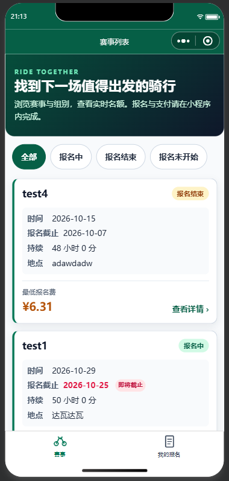

# 骑行赛事报名系统（bike-enroll）
一个骑行赛事报名系统（bike-enroll）
Vue 官网 + 管理后台 + 微信小程序 + Go 后端的一体化骑行赛事报名系统：官网展示赛事、小程序完成报名与支付、后台管理赛事与名单。



## 功能特性

| 功能 | 说明 |
|---|---|
| **个人报名** | 小程序内微信登录 → 选择组别 → 锁定名额 → 填写报名表 → 支付，全流程闭环 |
| **名额锁定** | 下单前用 Redis Lua 脚本原子预减名额，锁 15 分钟（可配）；超时由定时任务自动回补，避免超卖与占坑 |
| **Mock / 真实支付** | `PAYMENT_MODE=mock` 本地免签名联调；`wechat` 走微信支付 V3 JSAPI。生产环境禁止 mock，配置冲突时拒绝启动 |
| **报名开关** | 后台按赛事单独开启/关闭报名，前端实时反映「报名中 / 未开始 / 已结束」 |
| **名单导出** | 后台按赛事、组别、状态筛选并导出 Excel，单次上限 10000 条 |
| **统计看板** | 报名量、支付转化、退款等聚合指标 |
| **退款** | 申请 → 成功/关闭 的退款状态流转，支持重复回调幂等 |
| **订阅消息** | 可选：支付结果、报名结果模板消息推送（未配置则跳过，不影响主流程） |

## 技术栈

| 层次 | 技术 |
|---|---|
| 后端 | Go 1.26 · Gin · GORM · MySQL 8.0 · Redis 7 · golang-jwt v5 |
| 支付 | 微信支付 V3（JSAPI 下单、APIv3 AES-GCM 回调解密、RSA 验签）+ Mock Provider |
| 官网 | Vue 3.5 · Vite 8 · Vue Router 5 · Tailwind CSS 4 |
| 管理后台 | Vue 3.5 · Vite 8 · Element Plus 2.14 · Pinia 4 · Vue Router 5 |
| 小程序 | 原生 WXML / WXSS / JavaScript（无第三方框架） |
| 基础设施 | Docker Compose（MySQL / Redis / API）· pnpm 11 · k6（压测）· Playwright（截图） |

## 目录结构

```text
.
├── server/                 # Go 后端
│   ├── cmd/api/            # API 服务入口
│   ├── cmd/reconcile/      # 手动执行一次全量对账
│   ├── internal/           # config / handler / service / repository / model / middleware / pkg
│   ├── migrations/         # 10 组 golang-migrate 命名规范的 SQL 迁移
│   ├── configs/            # 运行时证书目录（仅 README，证书不入库）
│   └── tests/              # e2e 脚本与集成测试
├── website/                # Vue 官网（:5174）
├── admin/                  # Vue 管理后台（:5173）
├── miniapp/                # 微信小程序（微信开发者工具导入）
├── scripts/                # Playwright 截图脚本
├── tests/load/             # k6 压测脚本与结果
├── docs/                   # 设计、部署、配置文档与截图
│   ├── CONFIGURATION.md    # 环境变量详解
│   ├── deployment.md       # 部署手册
│   ├── openapi.yaml        # API 契约
│   └── screenshots/        # 项目截图
├── docker-compose.yml      # MySQL / Redis / API
├── .env.example            # 环境变量模板
└── LICENSE                 # MIT
```

## 截图

| 官网赛事列表 | 官网赛事详情 |
|---|---|
|  |  |

| 管理后台报名名单 | 微信小程序赛事列表 |
|---|---|
|  |  |

## 快速开始

### a. 环境要求

| 依赖 | 版本 | 说明 |
|---|---|---|
| Go | **1.26+** | `server/go.mod` 声明 `go 1.26.0` |
| Node.js | **20.19+**（推荐 22 LTS） | `website` / `admin` 的 `engines.node` 为 `>=20.19.0` |
| pnpm | **11.x** | 两个前端均锁定 `packageManager: pnpm@11.28.5` |
| Docker + Compose | 任意近期版本 | 运行 MySQL 8.0 / Redis 7 / API |
| 微信开发者工具 | 最新稳定版 | 仅调试小程序时需要 |

> 仓库没有 Makefile，也没有根级 `package.json`，所有命令均在各自子目录执行。

### b. 克隆与安装依赖

```bash
git clone <repo-url> bike-enroll
cd bike-enroll
```

```bash
# 官网
cd website && pnpm install && cd ..

# 管理后台
cd admin && pnpm install && cd ..

# 截图脚本（可选）
cd scripts && pnpm install && cd ..
```

### c. 配置 .env

```powershell
# Windows PowerShell
Copy-Item .env.example .env
```

```bash
# macOS / Linux
cp .env.example .env
```

模板见 [.env.example](.env.example)，完整字段说明见 [docs/CONFIGURATION.md](docs/CONFIGURATION.md)。**必须填写**以下 4 项，否则 `docker compose` 会直接报错退出：

| 必填项 | 说明 |
|---|---|
| `MYSQL_ROOT_PASSWORD` | MySQL root 密码（仅容器初始化用） |
| `MYSQL_USER` | 业务数据库账号 |
| `MYSQL_PASSWORD` | 业务数据库密码（代码无默认值） |
| `JWT_SECRET` | 至少 32 字节随机串：`openssl rand -hex 32` |

> ⚠️ 代码中没有弱口令兜底：`MYSQL_PASSWORD`、`JWT_SECRET` 缺失即失败，`JWT_SECRET` 还会拒绝曾公开过的默认值。

### d. 启动 MySQL / Redis

```bash
docker compose up -d mysql redis
```

两个服务仅绑定 `127.0.0.1`，不会暴露到局域网。等待健康检查通过：

```bash
docker compose ps
```

### e. 数据库迁移

仓库使用 **golang-migrate 的文件命名规范**（`000001_xxx.up.sql` / `.down.sql`），但没有内置迁移命令，直接按文件名顺序灌入即可。

PowerShell（Windows）：

```powershell
Get-ChildItem server/migrations/*.up.sql | Sort-Object Name | ForEach-Object {
  Get-Content -Raw $_.FullName |
    docker compose exec -T mysql sh -c 'mysql -u"$MYSQL_USER" -p"$MYSQL_PASSWORD" "$MYSQL_DATABASE"'
}
```

Bash（macOS / Linux）：

```bash
for f in $(ls server/migrations/*.up.sql | sort); do
  docker compose exec -T mysql sh -c 'mysql -u"$MYSQL_USER" -p"$MYSQL_PASSWORD" "$MYSQL_DATABASE"' < "$f"
done
```

验证迁移（注意：PowerShell 下 `-e "SHOW TABLES;"` 里的 `;` 会被当成命令分隔符，用管道传 SQL 更稳）：

```powershell
'SHOW TABLES;' | docker compose exec -T mysql sh -c 'mysql -u"$MYSQL_USER" -p"$MYSQL_PASSWORD" "$MYSQL_DATABASE"'
```

```bash
echo 'SHOW TABLES;' | docker compose exec -T mysql sh -c 'mysql -u"$MYSQL_USER" -p"$MYSQL_PASSWORD" "$MYSQL_DATABASE"'
```

预期输出 9 张表：`users`、`events`、`groups`、`disclaimer_signatures`、`enrollment_locks`、`enrollments`、`orders`、`notification_authorizations`、`refunds`。

### f. 启动后端、官网、管理后台

**方式一（推荐）：后端跑在容器里**，前端本地热更新。

```bash
docker compose up -d --build api
```

```bash
# 另开终端：官网 → http://localhost:5174
cd website && pnpm dev
```

```bash
# 另开终端：管理后台 → http://localhost:5173
cd admin && pnpm dev
```

**方式二：后端本地 `go run`**。注意 —— **API 只读进程环境变量，不会自动加载 `.env`**，必须先导出：

```powershell
$env:MYSQL_HOST='127.0.0.1'; $env:MYSQL_PORT='3306'
$env:MYSQL_USER='bike'; $env:MYSQL_PASSWORD='<你的密码>'; $env:MYSQL_DATABASE='bike_enroll'
$env:REDIS_ADDR='127.0.0.1:6379'; $env:REDIS_DB='0'
$env:JWT_SECRET='<openssl rand -hex 32 的结果>'
$env:APP_ENV='development'; $env:PAYMENT_MODE='mock'; $env:MOCK_PAY_SECRET='<随机串>'
cd server; go run ./cmd/api
```

两个前端的 `/api` 请求由 Vite 代理转发到 `http://localhost:8080`（见各自的 `vite.config.ts`），因此后端端口需保持 8080。

管理后台首次访问需要粘贴 **role=admin 的 JWT**，Token 保存在浏览器 `localStorage` 的 `bike_admin_token`。

### g. 小程序

1. 打开**微信开发者工具** → 导入项目 → 目录选择 `miniapp/`（`project.config.json` 已存在）。
2. AppID 默认为 `wx4001a36da9a3ec33`，请替换为你自己的小程序 AppID，并把对应的 `WECHAT_APPID` / `WECHAT_SECRET` 填入 `.env`。
3. 详情 → 本地设置 → 勾选**「不校验合法域名、web-view、TLS 版本以及 HTTPS 证书」**。`miniapp/config.js` 的 `API_BASE` 指向 `http://127.0.0.1:8080/api/v1`，不勾选会请求失败。
4. 编译运行；小程序启动时通过 `wx.login` → `POST /api/v1/auth/wechat-login` 换取 JWT。

## 环境变量说明

完整说明（含获取来源与常见错误）见 **[docs/CONFIGURATION.md](docs/CONFIGURATION.md)**。

| 字段名 | 必填 | 说明 | 来源 |
|---|---|---|---|
| `MYSQL_HOST` | 否 | 默认 `127.0.0.1`；compose 内固定为 `mysql` | 本地/容器 |
| `MYSQL_PORT` | 否 | 默认 `3306` | 本地/容器 |
| `MYSQL_USER` | **是** | 业务库账号 | 自建 |
| `MYSQL_PASSWORD` | **是** | 业务库密码，无默认值 | 自建 |
| `MYSQL_DATABASE` | 否 | 默认 `bike_enroll` | 自建 |
| `MYSQL_ROOT_PASSWORD` | **是**（compose） | MySQL 容器 root 密码，仅初始化用 | 自建 |
| `REDIS_ADDR` | 否 | 默认 `127.0.0.1:6379`；compose 内为 `redis:6379` | 本地/容器 |
| `REDIS_PASSWORD` | 否 | 无密码留空 | 自建 |
| `REDIS_DB` | 否 | 默认 `0` | — |
| `JWT_SECRET` | **是** | ≥32 字节随机串，启动时校验；拒绝已知默认值 | `openssl rand -hex 32` |
| `JWT_EXPIRE_HOURS` | 否 | 默认 `168`（7 天） | — |
| `WECHAT_APPID` | 小程序必填 | 小程序 AppID | mp.weixin.qq.com → 开发 → 开发设置 |
| `WECHAT_SECRET` | 小程序必填 | 小程序 AppSecret，**仅后端使用** | 同上（可重置） |
| `PAYMENT_MODE` | 否 | `mock` / `wechat`，默认 `wechat` | — |
| `MOCK_PAY_SECRET` | mock 模式必填 | mock 触发接口的 `X-Mock-Secret`，为空则接口一律 403 | 自定义随机串 |
| `WECHAT_PAY_MCHID` | wechat 模式必填 | 商户号 | pay.weixin.qq.com → 账户中心 → 商户信息 |
| `WECHAT_PAY_SERIAL_NO` | wechat 模式必填 | API 证书序列号 | 商户平台 → API 安全 → API 证书 |
| `WECHAT_PAY_APIV3_KEY` | wechat 模式必填 | APIv3 密钥（32 字节），回调解密用 | 商户平台 → API 安全 → APIv3 密钥 |
| `WECHAT_PAY_PRIVATE_KEY_PATH` | wechat 模式必填 | 商户私钥路径，默认 `./configs/apiclient_key.pem` | 证书工具生成，见 [configs/README.md](configs/README.md) |
| `WECHAT_PAY_NOTIFY_URL` | wechat 模式必填 | 公网 HTTPS 回调地址 | 你的域名 |
| `LOCK_TTL_MINUTES` | 否 | 名额锁定时长，默认 `15` | — |
| `PAY_TIMEOUT_MINUTES` | 否 | 支付超时关单，默认 `15` | — |
| `APP_ENV` | 否 | `development` / `production`；compose 默认 `production` | — |
| `API_PORT` | 否 | 宿主机映射端口，默认 `8080` | — |
| `LOG_LEVEL` | 否 | `debug` / `info` / `warn` / `error` | — |
| `TZ` | 否 | 默认 `Asia/Shanghai` | — |
| `GOPROXY` | 否 | 构建阶段 Go 模块代理 | — |
| `LOCK_TTL_SECONDS` | 否 | 压测用，>0 时优先于 `LOCK_TTL_MINUTES` | — |

以下 3 项代码支持但**未列入 `.env.example`**，需要时自行追加：

| 字段名 | 必填 | 说明 |
|---|---|---|
| `WECHAT_PAY_PLATFORM_CERT_PATH` | wechat 模式必填 | 微信支付平台证书路径，默认 `./configs/wechatpay_platform_cert.pem`，回调验签用 |
| `WECHAT_TPL_PAY_RESULT` | 否 | 支付结果订阅消息模板 ID |
| `WECHAT_TPL_ENROLL_RESULT` | 否 | 报名结果订阅消息模板 ID |

> ⚠️ **已知缺口**：`docker-compose.yml` 的 `api.environment` 没有透传 `WECHAT_PAY_APIV3_KEY` 和 `WECHAT_PAY_PLATFORM_CERT_PATH`。用 compose 跑 **真实微信支付** 时，需手动在这两个文件中补上映射，否则回调验签会因缺少密钥而失败：
>
> ```yaml
>       WECHAT_PAY_APIV3_KEY: ${WECHAT_PAY_APIV3_KEY:-}
>       WECHAT_PAY_PLATFORM_CERT_PATH: ${WECHAT_PAY_PLATFORM_CERT_PATH:-./configs/wechatpay_platform_cert.pem}
> ```
>
> 只用 `PAYMENT_MODE=mock` 时不受影响。

## 支付模式说明

`PAYMENT_MODE=mock` 时，后端会注册一组**不对外进入 OpenAPI 契约**的内部路由，用于在没有真实商户号的情况下跑通支付/退款全流程。请求必须带 `X-Mock-Secret` 头，值与 `MOCK_PAY_SECRET` 一致；未配置 `MOCK_PAY_SECRET` 时这些接口一律返回 403。

> 这些路由只在 `PAYMENT_MODE=mock` 下注册；`APP_ENV=production` 与 `PAYMENT_MODE=mock` 同时出现时，服务会**拒绝启动**（见 `server/internal/pkg/payment/factory.go`）。

### 触发支付成功

报名提交后拿到 `order_id`（提交报名接口响应中的 `order.id`）：

```bash
curl -X POST http://localhost:8080/internal/mock-pay/<order_id>/success \
  -H "X-Mock-Secret: <MOCK_PAY_SECRET>"
```

### 触发支付失败（金额不符分支）

```bash
curl -X POST http://localhost:8080/internal/mock-pay/<order_id>/fail \
  -H "X-Mock-Secret: <MOCK_PAY_SECRET>"
```

### 触发退款

```bash
# 1) 申请退款：订单进入 refunding
#    不传 out_refund_no 时自动生成 mock-refund-<order_id>
curl -X POST http://localhost:8080/internal/mock-refund/<order_id>/apply \
  -H "X-Mock-Secret: <MOCK_PAY_SECRET>"

# 2) 退款成功
curl -X POST http://localhost:8080/internal/mock-refund/<order_id>/success \
  -H "X-Mock-Secret: <MOCK_PAY_SECRET>"

# 3) 退款关闭（可选分支，另有 /closed）
curl -X POST http://localhost:8080/internal/mock-refund/<order_id>/closed \
  -H "X-Mock-Secret: <MOCK_PAY_SECRET>"
```

> 需要自定义退款单号时，追加
> `-H "Content-Type: application/json" -d '{"out_refund_no":"rf-001"}'`。
> PowerShell 5.1 把内嵌双引号传给原生命令时容易被吞掉，这类请求建议在 Git Bash / WSL 执行，
> 或改写成 `--data-raw '{\"out_refund_no\":\"rf-001\"}'`。

完整路由见 `server/internal/router/router.go` 的 `registerMockPay`；mock 回调最终调用与真实微信回调**相同的** `Service.HandleNotify`，因此幂等、状态机分支都能被真实验证。

## 数据库迁移命令

迁移文件位于 `server/migrations/`，共 10 组，命名遵循 golang-migrate：

```text
000001_create_users
000002_create_events_groups
000003_create_enrollment_locks
000004_create_enrollments_orders
000005_add_payment_fields
000006_create_notification_authorizations
000007_add_timeout_fields
000008_create_refunds
000009_split_event_registration_status
000010_add_event_end_time
```

**正向迁移**：见上文「e. 数据库迁移」的 PowerShell / Bash 循环。

**回滚**（按需手动执行单个 `down.sql`）：

```powershell
Get-Content -Raw server/migrations/000010_add_event_end_time.down.sql |
  docker compose exec -T mysql sh -c 'mysql -u"$MYSQL_USER" -p"$MYSQL_PASSWORD" "$MYSQL_DATABASE"'
```

**使用 golang-migrate CLI**（可选，需自行安装或使用镜像）：

```bash
docker run --rm --network bike-enroll-backend \
  -v "$PWD/server/migrations:/migrations" migrate/migrate \
  -path=/migrations \
  -database "mysql://bike:<password>@tcp(bike-enroll-mysql:3306)/bike_enroll" up
```

## 常见问题

### 1. 端口被占用

三个端口都是 `strictPort`，被占用会直接启动失败：

| 端口 | 服务 | 修改方式 |
|---|---|---|
| 8080 | API | 改 `.env` 的 `API_PORT`（compose）或 `HTTP_ADDR`（本地 `go run`）；同时要改两个前端 `vite.config.ts` 的代理 `target` |
| 5173 | 管理后台 | `admin/vite.config.ts` 的 `server.port` |
| 5174 | 官网 | `website/vite.config.ts` 的 `server.port` |
| 3306 / 6379 | MySQL / Redis | 改 `.env` 的 `MYSQL_PORT` / `REDIS_PORT`（仅影响宿主机映射） |

查看占用：

```powershell
Get-NetTCPConnection -State Listen | Where-Object LocalPort -in 8080,5173,5174
```

### 2. Mock 回调返回 403 / 404

- **403**：`X-Mock-Secret` 与 `MOCK_PAY_SECRET` 不一致，或 `MOCK_PAY_SECRET` 为空
  （响应 `mock pay secret invalid`）。
- **404**：两种可能 —— `PAYMENT_MODE` 不是 `mock`（路由未注册，返回纯文本 404）；
  或路由存在但订单号不存在（返回 JSON `{"code":"ORDER_NOT_FOUND"}`）。
- **409**：订单状态不允许退款（`ORDER_STATUS_INVALID`）或退款单号冲突（`REFUND_CONFLICT`）。
- **`/fail` 分支**：会构造金额不符的回调，用于验证 `PAY_AMOUNT_MISMATCH`，属预期行为。
- 重复调用 `/success` 是幂等的，第二次不会重复入账。

### 3. 证书放在哪里

商户私钥与平台证书放在 **`server/configs/`**（不是仓库根目录），容器以只读方式挂载：

```text
server/configs/
├── README.md
├── apiclient_key.pem              # 商户 API 私钥（不入库）
└── wechatpay_platform_cert.pem    # 微信支付平台证书（不入库）
```

获取步骤、权限要求（`chmod 600`）与轮换流程见 [server/configs/README.md](server/configs/README.md)；
在仓库根目录为什么看不到 `configs/` 见 [configs/README.md](configs/README.md)。

`*.pem` / `*.key` / `*.p12` / `*.pfx` 已被 `.gitignore` 排除，**不要**提交到仓库。

### 4. `go run ./cmd/api` 读不到 `.env`

API 只读进程环境变量，不会自动加载 `.env` 文件。本地运行时请按「f. 方式二」先导出环境变量，或直接用 `docker compose up -d --build api`（compose 会自动读根目录 `.env`）。

### 5. 管理后台页面空白 / 一直提示设置 Token

- 后台路由是 `/events`、`/enrollments`、`/stats`，**没有 `/admin` 前缀**（`admin/vite.config.ts` 未设置 `base`）。访问 `/admin/enrollments` 会匹配不到路由，只渲染导航外壳。
- Token 存在 `localStorage.bike_admin_token`，需要 `role=admin` 的 JWT；普通报名用户 Token 会被后台接口拒绝。

### 6. 小程序请求失败

- 未勾选「不校验合法域名」。
- 后端不在 `127.0.0.1:8080`，与 `miniapp/config.js` 的 `API_BASE` 不一致（真机调试需改成局域网 IP）。
- 未配置 `WECHAT_APPID` / `WECHAT_SECRET`，`wx.login` 换不到身份。

## 相关文档

- [docs/CONFIGURATION.md](docs/CONFIGURATION.md) — 环境变量详解、获取来源、常见错误
- [docs/deployment.md](docs/deployment.md) — 部署手册
- [docs/openapi.yaml](docs/openapi.yaml) — API 契约
- [docs/state-machine.md](docs/state-machine.md) — 报名/支付/退款状态机
- [docs/screenshots/README.md](docs/screenshots/README.md) — 截图说明与小程序截图指引

## License

本项目采用 [MIT License](LICENSE) 开源。

Copyright (c) 2026 bike-enroll contributors
